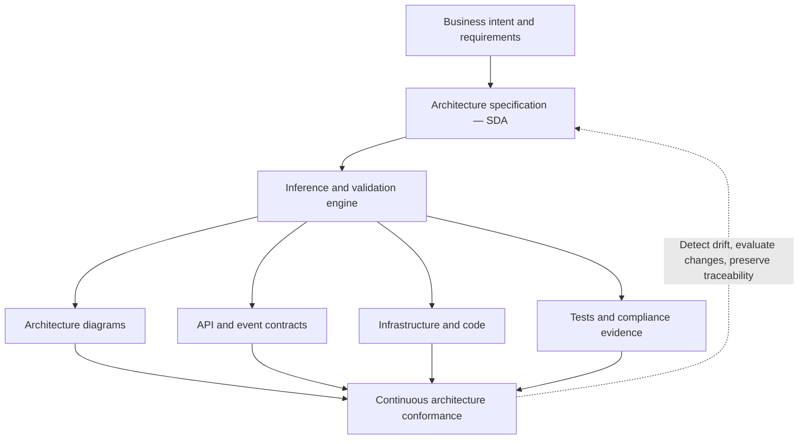
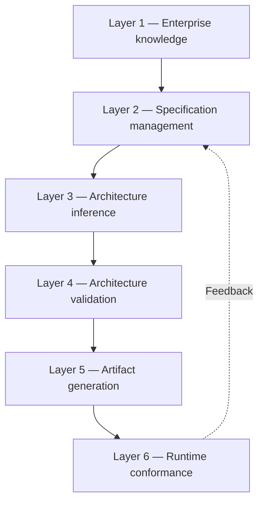

# Spec-Driven Architecture (SDA)

*Research, startup framework, inference-model techniques, tools, templates, implementation roadmap, and maturity index*

## 1. Executive overview

**Spec-Driven Architecture (SDA)** is a proposed architectural discipline that extends Spec-Driven Development (SDD) from individual software features into enterprise architecture, solution design, system integration, and architectural governance.

The central idea is straightforward:

> Architecture should not be merely documented after design decisions are made. It should be expressed as a structured, version-controlled, machine-interpretable specification that AI inference models can analyze, validate, refine, and translate into implementation artifacts.

The distinction is important. Spec-Driven Development typically focuses on defining requirements and generating or guiding implementation. Spec-Driven Architecture would establish the architectural constraints, system boundaries, interaction contracts, quality attributes, and decision policies that govern development across systems.

**Recommendation: establish SDA as a model-assisted, policy-governed architecture engineering methodology—not simply another AI code-generation workflow.**

### The transformation



- **Business intent and requirements:** capabilities, business processes, nonfunctional requirements.
- **Architecture specification:** architecture models, contracts, decisions, constraints, policies.
- **Inference and validation engine:** LLM reasoning, RAG, rule engines, static analysis, human approval.
- **Derived artifacts:** architecture diagrams, API/event contracts, infrastructure/code, tests/compliance evidence.
- **Continuous conformance:** detect drift, evaluate changes, update specifications, preserve traceability.

### What makes SDA different?

| Dimension | Spec-Driven Development | Proposed Spec-Driven Architecture |
|---|---|---|
| Primary scope | Features and applications | Systems and enterprise ecosystems |
| Core specification | Requirements, tasks, behavior | Capabilities, boundaries, contracts, quality attributes |
| AI responsibility | Plan and generate implementation | Infer, evaluate, recommend, and validate architecture |
| Governance | Code review and tests | Architectural policies, decisions, and conformance |
| Knowledge context | Application repository | Repositories, API catalogs, standards, ADRs, operational evidence |
| Main deliverable | Working software | Governed architectural specifications and derived artifacts |
| Lifecycle | Requirements to implementation | Business intent through operations and architecture evolution |

SDA is best treated as an emerging methodology to design and validate, rather than an already standardized industry framework. Its components are supported by established architecture-as-code, model-based engineering, contract-first design, and AI-assisted development practices.

## 2. Research foundation: what already exists

Several established technologies provide the building blocks for SDA. The opportunity is to integrate them into a coherent architecture-first workflow.

| Existing practice / technology | What it contributes to SDA | Remaining gap |
|---|---|---|
| [GitHub Spec Kit](https://github.github.com/spec-kit/) | Specification, planning, analysis, implementation and convergence workflows | Enterprise-wide architecture semantics |
| [Kiro](https://kiro.dev/docs/getting-started/first-project/) | AI-assisted requirements, design, tasks, and persistent project steering | Cross-system architecture governance |
| [Structurizr](https://docs.structurizr.com/dsl) / C4 | Architecture models as code and derived diagrams | Business-to-architecture inference |
| OpenAPI / AsyncAPI | Machine-readable service and event contracts | Enterprise architectural intent |
| Architecture Decision Records (ADRs) | Decision rationale and alternatives | Automated decision consistency |
| Open Policy Agent (OPA) | Deterministic policy evaluation | Natural-language architecture reasoning |
| RAG / knowledge graphs | Retrieval of enterprise context | Verified architectural interpretation |
| AI evaluation frameworks | Repeatable measurement of inference quality | Architecture-specific evaluation datasets |

GitHub's Spec Kit is especially relevant because it explicitly supports customizable processes beyond its default SDD workflow. Structurizr supplies the architecture-as-code foundation, while structured model outputs can enforce predictable machine-readable AI responses.

### The gap worth solving

Today's tools can generate code from specifications, create diagrams from models, and validate individual contracts.

The harder enterprise problem is maintaining a consistent chain of reasoning:

**Business objective → architecture requirements → architecture decisions → technical contracts → implementation → deployed system → compliance evidence.**

SDA should make this chain traceable, measurable, and continuously verifiable.

## 3. SDA reference architecture

I recommend six architectural layers.



1. **Layer 1 — Enterprise knowledge:** business capabilities, repositories, service catalogs, existing architecture, standards, operational evidence.
2. **Layer 2 — Specification management:** canonical SDA schema, specification registry, Git versioning, ownership and traceability.
3. **Layer 3 — Architecture inference:** LLMs, retrieval, architectural reasoning, pattern selection, alternative generation, evidence attribution.
4. **Layer 4 — Architecture validation:** schema validation, architecture policies, security checks, contract compatibility, cost and reliability analysis.
5. **Layer 5 — Artifact generation:** C4 models, OpenAPI, AsyncAPI, ADRs, IaC scaffolding, engineering tasks and test specifications.
6. **Layer 6 — Runtime conformance:** deployment inventory, telemetry, architecture drift, exceptions, and continuous feedback.

Cross-cutting requirements across all six layers should include identity and access control, audit trails, data classification, human approvals, provenance, and model evaluation.

### Key architectural design decision

Use a **canonical intermediate representation (IR)** as the central source of truth.

Do not make Mermaid diagrams, Markdown documents, or LLM responses the authoritative architecture.

Instead:

- Human-readable Markdown explains architectural intent.
- Structured YAML or JSON captures the architecture contract.
- JSON Schema validates its structure.
- Architecture rules validate its semantics.
- Generated diagrams and documents are derived views.
- Runtime evidence checks whether implementations conform.

This separation is essential for consistency and automation.

## 4. Canonical SDA specification model

A practical SDA specification should include the following domains.

| Domain | Required information | Example |
|---|---|---|
| Identity | ID, version, owner, lifecycle | SDA-PAY-001 |
| Business intent | Capability, objective, success metric | Real-time payments |
| Requirements | Functional and quality attributes | p95 latency under 300 ms |
| System context | Actors, dependencies, boundaries | Payment API, ledger |
| Components | Services, responsibilities, ownership | Payment orchestrator |
| Interactions | APIs, events, data flows | PaymentInitiated event |
| Data architecture | Classification, residency, retention | Confidential financial data |
| Security | Authentication, authorization, encryption | OAuth2, mTLS |
| Reliability | Availability, recovery objectives, failure handling | 99.95% availability |
| Technology constraints | Approved technologies and patterns | AWS, Kubernetes |
| Decisions | ADR references, alternatives, rationale | ADR-004 |
| Verification | Tests, evidence, policies | Contract test, OPA policy |
| Governance | Approvals, exceptions, expiration | Architecture board approval |

### Template A — Canonical architecture specification

```yaml
apiVersion: sda.example.org/v1alpha1
kind: ArchitectureSpecification

metadata:
  id: SDA-PAY-001
  name: Payment Processing Platform
  version: 0.1.0
  owner: payments-architecture
  status: proposed

business:
  capability: Payment Processing
  objectives:
    - id: OBJ-001
      statement: Process payments reliably
      metric: payment_success_rate
      target: ">=99.9%"

qualityAttributes:
  - id: QA-001
    name: availability
    target: ">=99.95%"
    measurementWindow: monthly
  - id: QA-002
    name: latency
    target: "p95 < 300ms"
    scope: synchronous-api

components:
  - id: payment-api
    type: service
    responsibility: Accept payment requests
  - id: payment-orchestrator
    type: service
    responsibility: Coordinate payment execution
  - id: ledger
    type: external-system
    responsibility: Record financial transactions

interactions:
  - source: payment-api
    target: payment-orchestrator
    protocol: HTTPS
    contract: contracts/payment-api.yaml
  - source: payment-orchestrator
    target: ledger
    protocol: HTTPS
    contract: contracts/ledger-api.yaml

constraints:
  - id: SEC-001
    rule: All service calls must authenticate
  - id: DATA-001
    rule: Sensitive data must be encrypted

decisions:
  - id: ADR-001
    path: decisions/ADR-001.md

verification:
  requiredChecks:
    - schema-validation
    - contract-validation
    - security-policy
    - architecture-review
```

*Illustrative SDA schema, not an existing industry standard. The sample targets are hypothetical; production targets require business approval and operational validation.*

The first engineering task is to publish an actual JSON Schema for this model. A parser should reject missing required fields, invalid component references, unknown contract locations, and inconsistent IDs.

## 5. How inference models should operate in SDA

The inference layer is the most distinctive part of the proposed methodology.

However, an LLM should not be trusted as the sole architectural authority. Use it for interpretation and recommendations, then verify its output with deterministic tools and human review.

### Five inference techniques

| Technique | SDA use case | Recommended approach |
|---|---|---|
| Retrieval-Augmented Generation | Find relevant internal architecture and standards | Hybrid search + reranking |
| Structured inference | Convert requirements into canonical architecture objects | JSON Schema-constrained outputs |
| Multi-step reasoning | Compare architecture alternatives | Explicit criteria and decision records |
| Graph-based reasoning | Analyze dependencies and change impact | Service dependency graph + graph queries |
| Critic/evaluator inference | Identify missing requirements and inconsistencies | Separate evaluator + deterministic validation |

### Proposed inference workflow

1. **Extract intent:** Identify business capabilities, requirements, constraints, assumptions and unanswered questions.
2. **Retrieve evidence:** Collect approved patterns, existing APIs, architecture decisions, and relevant source-code facts.
3. **Generate candidates:** Produce multiple viable architecture alternatives with explicit tradeoffs.
4. **Evaluate candidates:** Check quality attributes, security, operational feasibility, integration fit and cost assumptions.
5. **Create specification:** Generate structured SDA objects, contracts, decision records and diagrams.
6. **Verify and approve:** Run policy checks, record evidence and request architecture-owner approval.
7. **Observe implementation:** Compare actual deployed resources and service behavior with the approved specification.

### Inference reliability requirements

Every material AI-generated architectural recommendation should contain:

- A recommendation and the alternatives considered.
- Source references to the actual standards or system evidence.
- Explicit assumptions and unresolved questions.
- Confidence or evidence-strength indicators, calibrated through evaluation rather than treated as probabilities by default.
- Quality-attribute implications and tradeoffs.
- A clear distinction between verified facts and proposed design.
- The reviewer and approval status.

An important rule: **The inference model may propose an architecture change, but cannot silently approve it or modify production infrastructure.**

### Template B — Architecture inference prompt

```text
ROLE:
You are an enterprise solution architect operating
under the organization's SDA governance framework.

INPUTS:
- Business requirements
- Existing architecture specifications
- Approved technology standards
- Service/API catalog
- Relevant ADRs
- Nonfunctional requirements
- Evidence retrieved from source repositories

TASK:
1. Identify the architectural problem.
2. Extract explicit and implicit requirements.
3. Separate facts, assumptions, and unknowns.
4. Retrieve applicable architectural standards.
5. Generate at least two viable architecture options.
6. Evaluate each against quality attributes.
7. Identify security, reliability and data risks.
8. Recommend one option with justification.
9. Generate canonical SDA specification changes.
10. Produce proposed ADRs and verification tests.

GUARDRAILS:
- Never invent existing services or APIs.
- Cite evidence for claims about existing systems.
- Mark unsupported assumptions as unverified.
- Do not weaken mandatory security controls.
- Do not treat inferred architecture as approved.
- Do not modify production systems.

OUTPUT:
- Architecture proposal
- Structured SDA specification
- Alternative comparison
- Evidence and assumptions
- Proposed ADRs
- Validation findings
- Questions requiring human review
```

### Should you fine-tune a model?

Not initially.

Start with a strong general-purpose inference model, retrieval, structured output, and deterministic validation. Fine-tuning becomes worth evaluating only after collecting a substantial set of reviewed architecture decisions and identifying repeatable errors that retrieval and prompting cannot address.

A practical evaluation dataset could begin with 30–50 representative architecture cases and grow through pilot usage. Include both good designs and intentionally flawed designs.

## 6. Recommended technology stack

The most practical initial stack is Git-native, Python-based, and model-provider-neutral.

| Capability | Recommended tools | Priority |
|---|---|---|
| SDD workflow | GitHub Spec Kit | P0 |
| Source control / CI | GitHub or GitLab | P0 |
| Canonical schema | YAML, JSON Schema, Pydantic | P0 |
| Architecture modeling | Structurizr DSL / C4 | P0 |
| API specifications | OpenAPI, AsyncAPI | P0 |
| Inference orchestration | Python, model SDK, optional LangGraph | P0 |
| Model inference | Approved enterprise LLM endpoint | P0 |
| Policy-as-code | OPA, Conftest | P0 |
| API linting | Spectral | P1 |
| Documentation | MkDocs / Backstage | P1 |
| Knowledge retrieval | PostgreSQL + pgvector, hybrid search | P1 |
| Code intelligence | Tree-sitter, language servers, static analysis | P1 |
| Dependency graph | Neo4j or existing enterprise graph | P2 |
| Observability | OpenTelemetry and platform telemetry | P2 |
| Evaluation | Versioned architecture benchmark + evaluation runner | P0 |

P0 means essential for the initial pilot; P1 is the next capability to add; P2 is for broader scaling.

Structurizr is a strong choice because its DSL defines a common architecture model that can generate multiple C4 views. Spec Kit is useful as an extensible workflow engine rather than something you must replace.

### Architecture repository structure

```text
enterprise-architecture/
├── constitution/
│   ├── principles.md
│   ├── technology-standards.yaml
│   └── security-policies.yaml
├── schemas/
│   └── architecture-spec.schema.json
├── patterns/
│   ├── api-gateway.yaml
│   ├── event-driven.yaml
│   └── transactional-outbox.yaml
├── systems/
│   └── payment-platform/
│       ├── architecture.yaml
│       ├── requirements.md
│       ├── decisions/
│       │   └── ADR-001.md
│       ├── contracts/
│       │   └── payment-api.yaml
│       ├── models/
│       │   └── workspace.dsl
│       ├── verification/
│       │   └── evidence.json
│       └── generated/
├── policies/
│   ├── security/
│   ├── reliability/
│   └── architecture/
├── inference/
│   ├── prompts/
│   ├── schemas/
│   └── evaluators/
├── evaluations/
│   └── architecture-benchmark/
└── .github/
    └── workflows/
        └── architecture-checks.yml
```

Keep generated outputs separate from authoritative specifications. Each generated artifact should carry a specification version and generation metadata so that it can be reproduced and audited.

## 7. Architecture governance and validation

SDA should introduce three distinct types of checks.

| Validation level | Method | Example |
|---|---|---|
| Structural | JSON Schema / Pydantic | Every component must have an ID and owner |
| Semantic | OPA, graph checks, contract validators | Every external interaction requires an approved contract |
| Reasoning-based | LLM evaluator with evidence | Does the proposed design adequately address resilience? |

The first two are suitable for deterministic CI gates. The third should initially produce review findings, not automatic pass/fail decisions.

OPA and Conftest can enforce policies on structured architecture specifications in CI pipelines, while Spectral can lint OpenAPI and AsyncAPI contracts.

### Template C — Architecture policy

The following illustrative Rego policy requires a contract for every declared interaction.

```rego
package architecture

import rego.v1

deny contains msg if {
    some interaction in input.interactions
    not interaction.contract

    msg := sprintf(
        "Missing contract: %s -> %s",
        [interaction.source, interaction.target]
    )
}

deny contains msg if {
    some component in input.components
    not component.responsibility

    msg := sprintf(
        "Missing responsibility: %s",
        [component.id]
    )
}
```

In a real implementation, the policy input must be normalized to the architecture specification object. Additional rules should verify that references resolve and that contract files exist.

### Proposed architecture pull-request gates

| Check | Gate type |
|---|---|
| Schema validation | Blocking |
| Component and relationship validation | Blocking |
| API / event contract linting | Blocking |
| Security and architecture policies | Blocking |
| Architecture inference critique | Advisory |
| Architectural decision approval | Human gate |

Exceptions should be documented with a reason, owner, approval, expiration date, and compensating controls.

## 8. Startup roadmap: first 180 days

I recommend a six-month rollout, starting with a single architecture domain and expanding only after measurable success.

| Phase | Timing | Cumulative elapsed-time indicator |
|---|---|---|
| Foundation | Weeks 1–2 | 12% |
| Specification framework | Weeks 3–4 | 24% |
| Inference prototype | Weeks 5–8 | 46% |
| Pilot and validation | Weeks 9–12 | 67% |
| Operational integration | Weeks 13–18 | 84% |
| Scale readiness | Weeks 19–26 | 100% |

*Percentages above represent cumulative elapsed time, not implementation completion.*

### Phase deliverables

| Phase | Activities | Exit criteria |
|---|---|---|
| 1. Foundation | Select pilot, assign owners, baseline current process | Sponsor, scope, success metrics agreed |
| 2. Specification | Publish canonical schema, templates, ADR format, initial policies | First valid SDA specification merged |
| 3. Inference | Build retrieval, structured generation, alternative analysis | Inference passes benchmark threshold |
| 4. Pilot | Run SDA on 2–3 system changes; compare against existing process | Reviewers approve usefulness and correctness |
| 5. Integration | Add CI gates, contract validation, artifact generation | Automated checks run on every pilot PR |
| 6. Scale | Publish playbook, onboarding, dashboards, reusable patterns | Second team can adopt with limited assistance |

### Recommended initial team

| Role | Allocation during pilot |
|---|---:|
| Architecture lead / SDA owner | 0.5 FTE |
| Platform engineer | 1.0 FTE |
| AI / inference engineer | 1.0 FTE |
| Solution architect / domain SME | 0.5 FTE |
| Security / governance reviewer | 0.2 FTE |
| Product or program owner | 0.2 FTE |

Approximately **3.4 FTE** of combined effort is a reasonable planning assumption for a focused pilot, not a universal staffing requirement.

### Pilot selection criteria

Select a system that has existing APIs, accessible architecture documentation, a manageable dependency footprint, and a real upcoming change.

Avoid starting with an entire enterprise landscape or a highly regulated production migration that requires extensive approvals before any experiment can occur.

## 9. SDA maturity index (SDA-MI)

I propose a five-level maturity model, inspired by the general structure of capability maturity assessments but specifically designed for SDA.

| Level | Name | Description |
|---|---|---|
| 1 | Documented | Architecture exists primarily as manually maintained documents. |
| 2 | Structured | Architecture is versioned and expressed through consistent schemas. |
| 3 | Validated | Contracts and architectural policies are checked automatically. |
| 4 | Inference-assisted | Evidence-grounded AI supports design, impact analysis and reviews. |
| 5 | Continuously governed | Specifications, implementation evidence and runtime drift are connected. |

### Assessment dimensions

Each dimension is scored from 0 to 5.

| Dimension | Weight |
|---|---:|
| Specification standardization | 15% |
| Architecture-as-code adoption | 15% |
| Contract and policy validation | 15% |
| AI inference capability | 15% |
| Knowledge retrieval and provenance | 10% |
| Requirements-to-runtime traceability | 10% |
| CI/CD and operational integration | 10% |
| Governance and human accountability | 10% |
| **Total** | **100%** |

The weighted SDA-MI score is:

$$
\text{SDA-MI}=\sum_{i=1}^{8}\left(\frac{s_i}{5}\times w_i\right)
$$

where $s_i$ is the dimension's 0–5 score and $w_i$ is its percentage weight.

### Interactive maturity assessment — static Markdown equivalent

The original response included interactive sliders. This Markdown file preserves the assessment's dimensions, weights, initial example values, formula, thresholds, and copyable scorecard, but standard Markdown does not support functioning sliders.

| Dimension | Weight | Illustrative initial score (0–5) |
|---|---:|---:|
| Specification standardization | 15% | 2 |
| Architecture as code | 15% | 1 |
| Contract and policy validation | 15% | 1 |
| AI inference capability | 15% | 1 |
| Knowledge and provenance | 10% | 1 |
| End-to-end traceability | 10% | 1 |
| CI/CD and runtime integration | 10% | 1 |
| Governance and accountability | 10% | 2 |

**Illustrative initial result: 26/100 — Documented.**

The original interactive assessment classified index values as follows:

| Score | Classification |
|---|---|
| 0–19 | Initial |
| 20–39 | Documented |
| 40–59 | Structured |
| 60–74 | Validated |
| 75–89 | Inference-assisted |
| 90–100 | Continuously governed |

*Scoring interpretation is a proposed SDA assessment framework, not an externally certified maturity model. Scores should ultimately be supported by evidence.*

### Maturity gates

A high weighted score should not conceal serious weaknesses. For example, an organization with sophisticated inference but no security policy validation should not qualify as continuously governed.

I recommend the following minimum gates:

- Level 3 requires structured specifications and automated validation.
- Level 4 requires documented inference evaluations, provenance, and human approval.
- Level 5 requires runtime conformance monitoring and controlled exception management.

## 10. SDA performance metrics

The maturity index measures capability. You also need operational KPIs to determine whether SDA actually improves architecture engineering.

| KPI | Measurement | Illustrative pilot target |
|---|---|---|
| Architecture preparation time | Median hours per comparable design | 25% reduction |
| Specification completeness | Required fields and evidence present | 95% |
| Contract coverage | Interactions with validated contracts | 90% |
| Architectural traceability | Requirements linked to design and verification | 90% |
| AI recommendation acceptance | Reviewer-accepted recommendations / reviewed recommendations | 75% |
| Critical inference error rate | Materially incorrect findings / evaluated findings | Under 2% |
| Policy coverage | Mandatory controls represented by automated checks | 80% |
| Architecture drift detection | Time from detectable deviation to finding | Under 24 hours |
| Exception hygiene | Active exceptions with owner and expiry | 100% |

These are proposed targets to validate during the pilot. Do not claim time savings until measured against comparable historical or control projects.

For inference quality, measure false positives, false negatives, unsupported claims, and architectural severity separately. A high acceptance rate alone does not establish reliability.

## 11. Worked example: SDA for enterprise API modernization

Consider an organization modernizing a legacy payment interface.

**Business requirement:** Expose a modern payment initiation API while retaining a legacy ledger system.

The architecture inference engine retrieves the existing ledger interface, approved authentication standards, service dependencies, relevant ADRs, and existing API contracts.

It then evaluates alternatives.

| Architecture option | Advantages | Risks |
|---|---|---|
| Direct API-to-ledger integration | Simple, fewer components | Tight coupling, legacy exposure |
| API gateway + orchestration service | Centralized policy enforcement, clearer responsibilities | More operational components |
| Event-driven payment processing | Decoupling, asynchronous resilience | More complex consistency and lifecycle management |

The inference engine should not automatically choose event-driven architecture merely because it is fashionable. It should determine whether asynchronous processing is compatible with the business requirements, payment acknowledgment semantics, and downstream ledger capabilities.

For example, if the business requires a definitive synchronous confirmation of ledger posting, an event-driven design needs additional acknowledgment semantics or a revised business contract.

### Expected SDA outputs

- **Approved architecture specification**
- **C4 context and container diagrams**
- **OpenAPI and event contracts**
- **Architecture decision record**
- **Security and policy validation results**
- **Engineering implementation tasks**

The same architecture specification should support change-impact analysis later. For example, when a ledger API changes, SDA can identify affected interactions, contracts, components, decisions, and verification requirements.

## 12. Templates to standardize from day one

In addition to the canonical specification and inference prompt, establish these reusable templates.

### Template D — Architecture Decision Record

```markdown
# ADR-001: Architecture Decision Title

## Status
Proposed | Accepted | Superseded | Rejected

## Business Context
What business capability or problem is addressed?

## Requirements
- Functional requirements
- Quality attributes
- Regulatory constraints

## Architecture Options
### Option A
Description, advantages, disadvantages

### Option B
Description, advantages, disadvantages

## Decision
Selected option and rationale

## Tradeoffs
Cost, complexity, security, resilience,
maintainability and operational impact

## Evidence
Links to standards, benchmarks, source artifacts

## Verification
Tests and evidence required to confirm the design

## Governance
Owner:
Approver:
Date:
Review trigger:
```

### Template E — Architecture review checklist

**SDA review readiness: 0/10 completed (initial state).**

- [ ] Business capability and requirements identified
- [ ] System boundaries and dependencies defined
- [ ] Quality attributes measurable and testable
- [ ] Data classification and trust boundaries recorded
- [ ] API and event contracts identified
- [ ] Architecture alternatives and tradeoffs documented
- [ ] Security and regulatory requirements evaluated
- [ ] Failure modes and recovery behavior reviewed
- [ ] Architecture policies and automated checks passed
- [ ] Human approvals and exception records completed

## 13. Major risks and mitigation

| Risk | Mitigation |
|---|---|
| Hallucinated dependencies | Require source-backed evidence and reference resolution |
| Incorrect architecture recommendations | Use benchmark evaluations and mandatory expert review |
| Outdated RAG knowledge | Track source version, timestamp, owner and retrieval provenance |
| Sensitive information leakage | Apply classification-aware retrieval and approved model endpoints |
| Specification drift | Compare code, contracts and runtime evidence against approved specs |
| Excessive process overhead | Automate checks and keep schemas proportional to system criticality |
| Vendor lock-in | Keep canonical specs, policies and evaluation datasets model-neutral |
| False confidence in AI scores | Calibrate against reviewed cases and measure critical errors |

For regulated or financial systems, I would require stronger controls around access to source code, customer data, architectural secrets, model logging, and generated infrastructure changes.

## 14. What I would build first: an SDA minimum viable platform

A useful first release does not need a complicated multi-agent architecture or enterprise knowledge graph.

Build five capabilities:

1. **SDA specification registry:** Git-managed architecture specifications, schema validation, and version history.
2. **Architecture inference service:** Requirements plus retrieved context produce structured architecture proposals and ADR drafts.
3. **Architecture model generator:** Converts approved canonical specifications into C4 models and diagrams.
4. **Architecture policy validator:** Checks component relationships, contracts, security requirements, and mandatory architectural standards.
5. **Review and evaluation workflow:** Human approval, evaluation datasets, evidence, and audit history.

The MVP is successful when a real architectural change can move from requirements to an approved specification, derived contracts and diagrams, and automated verification without losing traceability.

### Recommended first 30 days

| Week | Concrete outcome |
|---|---|
| 1 | SDA charter, pilot system, owners, baseline metrics |
| 2 | Canonical schema v0.1, repository, architecture constitution |
| 3 | First architecture specification, C4 generation, policy checks |
| 4 | Initial inference pipeline, benchmark cases, review demonstration |

The first demonstration should show both a successful architecture proposal and a deliberately noncompliant proposal being detected by validation.

## 15. Longer-term research and innovation opportunities

If the goal is to establish SDA as a distinct methodology or potentially build a startup around it, I see four particularly valuable areas.

**Architecture inference from existing code:** Use repository analysis, API definitions, configuration files, and runtime evidence to reconstruct an architecture model. The system should distinguish observed architecture from inferred intent.

**Architecture change-impact intelligence:** Use a dependency graph to identify which services, contracts, data flows, and architectural decisions are affected by a proposed change.

**Architecture evaluation benchmarks:** Build a curated dataset of architectural scenarios, alternatives, known design defects, and expert judgments. This could become one of SDA's most defensible assets.

**Continuous architecture conformance:** Connect the specification to infrastructure, service discovery, deployments, and telemetry so architectural drift becomes observable rather than merely discovered during periodic reviews.

The commercial opportunity is not another diagram generator. It is a trustworthy **architecture intelligence and governance layer** connecting business intent, AI-assisted design, and actual engineering systems.

## 16. Research references and implementation resources

These are the most useful starting points from the research.

| Resource | Why it matters |
|---|---|
| [GitHub Spec Kit](https://github.github.com/spec-kit/) | Extensible SDD process foundation |
| [Kiro specifications and steering](https://kiro.dev/docs/getting-started/first-project/) | Persistent AI development context |
| [Structurizr DSL](https://docs.structurizr.com/dsl) | Architecture as code |
| [AsyncAPI](https://www.asyncapi.com/docs) | Event-driven interface specifications |
| [Open Policy Agent](https://www.openpolicyagent.org/docs) | Architecture policy enforcement |
| [Conftest](https://www.conftest.dev/documentation/) | Configuration and policy testing |
| [Spectral](https://stoplight.io/open-source/spectral) | API contract governance |
| [Structured model outputs](https://developers.openai.com/api/docs/guides/structured-outputs) | Machine-readable inference outputs |

## Final recommendation

I would position this initiative under the following working definition:

> **Spec-Driven Architecture is an AI-assisted architecture engineering methodology in which business intent, system structure, quality attributes, integration contracts, and architectural policies are maintained as versioned, machine-verifiable specifications. Inference models help derive and evaluate architecture proposals, while deterministic validation and human governance ensure architectural integrity throughout the software lifecycle.**

Start with the canonical SDA schema, inference engine, policy checks, and maturity assessment. Prove them on one API-centric enterprise system before expanding to cross-domain architecture governance.

The most important strategic distinction is that **SDD makes software implementation specification-driven; SDA makes architecture decisions, architectural knowledge, and architectural evolution specification-driven.**

That is the foundation on which a credible methodology, open-source framework, enterprise platform, or commercial product could be developed.
